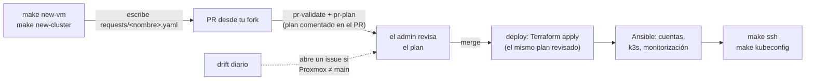

# pve-platform-iac

[English](README.md) · **Español**

[](LICENSE)


**Autoservicio de VMs y clusters k3s en tu propio Proxmox VE.** Los equipos piden infraestructura
con un pull request, **sin saber Terraform ni Ansible y sin ninguna credencial de
infraestructura**. Un admin revisa el plan y mergea, y solo el pipeline lo aplica, igual que Argo CD
gestiona las aplicaciones.

> [!NOTE]
> **Beta (v0.1.0).** La interfaz y la configuración aún pueden cambiar antes de la 1.0.

## Qué problema resuelve

Dentro de una empresa, los equipos pequeños (un proyecto, un grupo de trabajo, una PoC, una demo
para un cliente) necesitan sus VMs y clusters **ya**, pero la infraestructura es de otros. Suelen
acabar con:

- **VMs pedidas por ticket o por chat**, esperando a quien tiene la contraseña de root.
- **Admins aplicando cambios desde su portátil** con tokens con mucho poder y sin registro de quién
  cambió qué.
- **VMs olvidadas** que consumen capacidad compartida, y **clusters montados a mano** que nadie sabe
  reconstruir.

pve-platform-iac lleva un **flujo GitOps profesional a equipos autogestionados sobre
infraestructura propia**: los equipos ganan autonomía en su día a día y los admins conservan la
revisión, los límites y la trazabilidad. Es una puesta en marcha de autoservicio para equipos, no un
sustituto de la estrategia de infraestructura de la organización: decide con tu equipo de infra
dónde encaja (qué cluster, qué redes, qué proyectos). En la práctica:

- **Cada VM es un YAML en `requests/`.** Crear, redimensionar o borrar una es un PR revisado, con su
  plan de Terraform comentado, y git es el registro de auditoría.
- **Un catálogo cerrado** de tamaños y perfiles mantiene la capacidad previsible. Cada instalación
  añade los suyos (una VM de base de datos, un runner de CI…).
- **Aislamiento por proyecto:** cada proyecto tiene su pool de Proxmox y sus rangos de VMID e IP, y
  solo sus miembros tienen cuenta en sus VMs, con sus claves SSH de GitHub.
- **Clusters pensados para fallar:** un cluster k3s es un master y N workers repartidos por turnos
  entre los nodos físicos; si cae un nodo, cae una parte del cluster, no el cluster entero.
- **Nadie tiene credenciales de infraestructura:** solo aplica el pipeline, desde `main`. La
  detección de deriva diaria avisa cuando Proxmox ya no coincide con git.

> [!NOTE]
> **Quién hace qué**
> - **Dev:** pide VMs y clusters con `make new-vm` / `make new-cluster` y un PR desde su fork.
>   Entra con su usuario de GitHub y sus claves SSH. No necesita token de Proxmox, ni de HCP, ni
>   nada.
> - **Admin** (en `admins` de [`projects.yaml`](projects.yaml)): revisa y mergea los PR, gestiona
>   proyectos, catálogo y secretos del pipeline, e instala la plataforma una vez.



## Qué puedes pedir

| Necesitas | Pide | Obtienes |
|---|---|---|
| Una VM Linux | `make new-vm`, perfil `vm` | Ubuntu 24.04 con tu cuenta, sudo, chrony y node-exporter |
| Monitorizar tus VMs | `make new-vm`, perfil `monitoring` | Prometheus + Grafana que recogen métricas de todas las VMs del repo |
| Un cluster de Kubernetes | `make new-cluster` | k3s: 1 master + N workers repartidos entre los nodos de Proxmox, kubeconfig con `make kubeconfig` |

Los tamaños (vCPU, RAM, disco) están en el [catálogo](docs/peticiones.md#catálogo), generado desde
`catalog/`. Los admins añaden sus propios flavors, familias de cluster y perfiles
([cómo](docs/operador.md#ampliar-el-catálogo)).

## Para devs: de cero a tu primera VM

Necesitas una cuenta de GitHub con una clave SSH, ser miembro de un proyecto (el admin te añade a
`projects.yaml`), `git`, `make`, `python3-yaml` y, mejor, [`gh`](https://cli.github.com). Para
entrar en las VMs, además, acceso a su red (Cloudflare WARP, si tu instalación lo usa).

```sh
# 1. Fork, clon y comprobación
gh repo fork <OWNER>/pve-platform-iac --clone --remote
cd pve-platform-iac
make setup && make doctor          # quién eres en GitHub, tus proyectos y tus claves

# 2. Pide una VM o un cluster (el asistente elige VMID e IP libres en el rango de tu proyecto)
git switch -c pide-<nombre>
make new-vm                        # o: make new-cluster

# 3. Abre el PR
git add requests/ && git commit -m "Pide <nombre>"
git push -u origin pide-<nombre>
gh pr create --repo <OWNER>/pve-platform-iac --fill
```

4. **Lee el plan** que comenta `pr-plan` en tu PR. Solo debe aparecer `+ crear` de lo que has
   pedido. Si ves que se **destruye o recrea** algo que no has borrado, para y avisa al admin.
5. **Tras el merge** (2-5 minutos después), entra:

   ```sh
   make ssh NAME=<vm>                 # tu usuario de GitHub, con sudo
   make kubeconfig NAME=<cluster>     # kubeconfig en ansible/kubeconfigs/<cluster>.yaml
   ```
6. **Cámbialo o bórralo** con otro PR: edita `flavor` o `workers` en tu fichero, o ejecuta
   `make remove NAME=<nombre>` cuando termines. La capacidad es compartida.

> [!CAUTION]
> No edites nunca `vmid` ni `ip` a mano ni renombres un fichero de petición: **renombrar destruye
> la VM y sus discos** y crea una vacía. Reglas: [docs/peticiones.md](docs/peticiones.md#reglas-comunes).

Guía completa paso a paso, todos los campos y problemas: [docs/peticiones.md](docs/peticiones.md).

### Problemas frecuentes

| Síntoma | Arreglo |
|---|---|
| `make doctor`: «proyectos: ninguno» | No estás en `members` de ningún proyecto: pídeselo al admin |
| `iac check`: «fuera de los rangos de …» | `vmid`/`ip` editados a mano: regenera la petición con `make new-vm` |
| El PR no tiene comentario de plan | Tu PR toca algo más que `requests/` (sepáralo) o, en un repo público, un admin aún no le ha puesto la etiqueta `plan` |
| `Permission denied (publickey)` | Tu clave no está en tu perfil de GitHub, o el deploy no ha terminado |
| `No route to host` con `make ssh` | No estás en la red de las VMs (revisa WARP), o el deploy no ha terminado |
| «HOST IDENTIFICATION HAS CHANGED» con `make ssh` | **No entres**: avisa al admin |

## Para admins: tu propia instalación

| Componente | Obligatorio | Notas |
|---|---|---|
| Proxmox VE 8.4+ / 9.x | sí | De 1 a N nodos. Se instala con [platform-proxmox](https://github.com/teo-devops/platform-proxmox) |
| GitHub | sí | Organización (recomendada para empresas) o cuenta personal con repo público |
| Un host Docker pequeño junto al cluster | sí | Runners propios efímeros (`runner/`) |
| HCP Terraform (Free) | sí | Solo estado y bloqueo; los plan y apply corren en tus runners |
| Cloudflare Zero Trust (Free) | opcional | VPN para que los devs lleguen a sus VMs |
| Proxmox Backup Server + S3 | opcional | Copias cifradas y deduplicadas |

```sh
gh repo create <owner>/pve-platform-iac --private --template teo-devops/pve-platform-iac --clone
cd pve-platform-iac
make init OWNER=@<owner>/<equipo-admins>   # tu configuración desde examples/, tu CODEOWNERS
make check
make preflight                             # dice lo que falta
```

Después sigue [docs/bootstrap.md](docs/bootstrap.md): rulesets y environments de GitHub, HCP, tokens
y CA de Proxmox, runners, primer deploy, VPN y copias. El día a día: [docs/operador.md](docs/operador.md).

## Seguridad, en resumen

- **El código sin revisar nunca ve secretos:** los PR se validan en runners de GitHub sin secretos,
  y el plan del PR ejecuta el código de `main` con solo los YAML del PR.
- **Se aplica exactamente lo revisado:** el plan viaja cifrado entre jobs y se aplica byte a byte.
- **Privilegios mínimos:** los tokens de Proxmox solo tienen ACL en los pools de los proyectos (nada
  en `/`), sin SSH a los nodos, con TLS y claves de host siempre verificados.
- **Cadena de suministro fijada:** imagen base por release fechada, sha256 y firma GPG; actions por SHA.

Modelo de amenazas, controles (R-nn), riesgos aceptados (A-n) e inventario de secretos:
[docs/seguridad.md](docs/seguridad.md). Reportar una vulnerabilidad: [SECURITY.md](SECURITY.md).

## Documentación

| Documento | Para |
|---|---|
| [docs/peticiones.md](docs/peticiones.md) | **Devs:** pedir, usar, cambiar y borrar VMs y clusters; cada campo; problemas |
| [docs/bootstrap.md](docs/bootstrap.md) | **Admins, una vez:** montarlo todo desde cero |
| [docs/operador.md](docs/operador.md) | **Admins, día a día:** revisar PR, proyectos y personas, ampliar el catálogo, break-glass |
| [docs/runbooks.md](docs/runbooks.md) | **Admins, incidentes:** deriva, claves de host, apply fallido, lock del estado, runners, secretos filtrados, restauraciones |
| [docs/diseno.md](docs/diseno.md) | Cómo funciona y por qué: arquitectura, pipeline y decisiones de diseño (D-nn) |
| [docs/seguridad.md](docs/seguridad.md) | Modelo de amenazas, controles, riesgos aceptados y secretos |

`make` a secas lista todos los comandos.

### Estructura del repositorio

| Ruta | Qué es | ¿Lo tocas como dev? |
|---|---|---|
| `requests/` | Un YAML por VM o cluster | Sí, con `make new-vm` / `make new-cluster` / `make remove` |
| `projects.yaml` | Admins, proyectos, sus pools, rangos y miembros | No (admin) |
| `platform.yaml` | Nodos de Proxmox, red, almacenamiento e imagen base fijada | No (admin) |
| `catalog/` | Flavors, familias de cluster y perfiles | No (admin, por PR) |
| `terraform/`, `ansible/` | Aprovisionamiento y configuración | No |
| `scripts/iac`, `Makefile` | La CLI detrás de `make` | No |
| `.github/workflows/`, `runner/` | Pipeline y runners propios | No (admin) |

## Contribuir y licencia

Issues y PR bienvenidos: [CONTRIBUTING.md](CONTRIBUTING.md). Licencia
[Apache-2.0](LICENSE).
