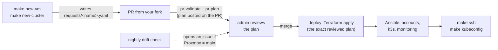

# pve-platform-iac

**English** · [Español](README.es.md)

[](LICENSE)


**Self-service VMs and k3s clusters on your own Proxmox VE.** Teams ask for infrastructure with a
pull request, **without knowing Terraform or Ansible and without any infrastructure
credentials**. An admin reviews the plan, merges, and only the pipeline applies it, the same way
Argo CD manages applications.

> [!NOTE]
> **Beta (v0.1.0).** Interfaces and configuration may still change before 1.0.

## The problem it solves

Inside a company, small teams (a project, a working group, a PoC, a demo for a client) often need
their own VMs and clusters **now**, but the infrastructure belongs to someone else. They usually
end up with:

- **VMs requested by ticket or chat**, waiting on whoever has the root password.
- **Admins applying changes from their laptops** with powerful tokens and no record of who changed
  what.
- **Forgotten VMs** eating shared capacity, and **clusters built by hand** that nobody can
  rebuild.

pve-platform-iac brings a **professional GitOps workflow to self-managed teams on your own
infrastructure**: teams become autonomous for their day-to-day needs, while admins keep the
review, the limits and the audit trail. It is a starting point for team self-service, not a
replacement for your organization's infrastructure strategy: decide with your infra team where it
fits (which cluster, which networks, which projects). In practice:

- **Every VM is a YAML file in `requests/`.** Creating, resizing or deleting one is a reviewed PR,
  with its Terraform plan posted on it, and git is the audit trail.
- **A closed catalog** of sizes and profiles keeps capacity predictable. Each installation adds its
  own (a database VM, a CI runner…).
- **Per-project isolation:** each project has its own Proxmox pool and VMID/IP ranges, and only its
  members get an account on its VMs, with their GitHub SSH keys.
- **Clusters built for failure:** a k3s cluster is a master plus N workers spread round-robin
  across the physical nodes, so losing a node takes down part of the cluster, not all of it.
- **Nobody holds infrastructure credentials:** only the pipeline applies, from `main`. Nightly drift
  detection tells you when Proxmox no longer matches git.

> [!NOTE]
> **Who does what**
> - **Developer:** asks for VMs and clusters with `make new-vm` / `make new-cluster` and a PR from
>   their fork. Logs in with their GitHub username and SSH keys. Needs no Proxmox token, no HCP
>   token, nothing.
> - **Admin** (listed under `admins` in [`projects.yaml`](projects.yaml)): reviews and merges PRs,
>   manages projects, the catalog and the pipeline secrets, and installs the platform once.



## What you can request

| You need | Ask for | You get |
|---|---|---|
| A plain Linux VM | `make new-vm`, profile `vm` | Ubuntu 24.04 with your account, sudo, chrony and node-exporter |
| Monitoring for your VMs | `make new-vm`, profile `monitoring` | Prometheus + Grafana scraping every VM in the repo |
| A Kubernetes cluster | `make new-cluster` | k3s: 1 master + N workers spread across the Proxmox nodes, kubeconfig with `make kubeconfig` |

Sizes (vCPU, RAM, disk) live in the [catalog](docs/peticiones.md#catálogo), generated from
`catalog/`. Admins add their own flavors, cluster families and profiles
([how](docs/operador.md#ampliar-el-catálogo)).

## For developers: from zero to your first VM

You need a GitHub account with an SSH key, membership of a project (the admin adds you to
`projects.yaml`), `git`, `make`, `python3-yaml` and ideally [`gh`](https://cli.github.com). To log
in to the VMs you also need access to their network (Cloudflare WARP, if your installation uses it).

```sh
# 1. Fork, clone and check that you are set up
gh repo fork <OWNER>/pve-platform-iac --clone --remote
cd pve-platform-iac
make setup && make doctor          # who you are on GitHub, your projects, your keys

# 2. Ask for a VM or a cluster (the wizard picks a free VMID and IP in your project's range)
git switch -c ask-<name>
make new-vm                        # or: make new-cluster

# 3. Open the PR
git add requests/ && git commit -m "Ask for <name>"
git push -u origin ask-<name>
gh pr create --repo <OWNER>/pve-platform-iac --fill
```

4. **Read the plan** that `pr-plan` posts on your PR. Expect only `+ create` for what you asked
   for. If you see something being **destroyed or replaced** that you did not delete, stop and tell
   the admin.
5. **Once merged** (2–5 minutes later), log in:

   ```sh
   make ssh NAME=<vm>                 # your GitHub username, with sudo
   make kubeconfig NAME=<cluster>     # kubeconfig in ansible/kubeconfigs/<cluster>.yaml
   ```
6. **Change or delete it** with another PR: edit `flavor` or `workers` in your file, or run
   `make remove NAME=<name>` when you are done. Capacity is shared.

> [!CAUTION]
> Never edit `vmid` or `ip` by hand and never rename a request file: **renaming destroys the VM
> and its disks** and creates an empty one. Rules: [docs/peticiones.md](docs/peticiones.md#reglas-comunes).

Full step-by-step guide, every field and troubleshooting: [docs/peticiones.md](docs/peticiones.md)
(in Spanish).

### Common problems

| Symptom | Fix |
|---|---|
| `make doctor`: "projects: none" | You are not in any project's `members`: ask the admin |
| `iac check`: "out of the ranges of …" | `vmid`/`ip` edited by hand: regenerate the request with `make new-vm` |
| No plan comment on the PR | Your PR touches more than `requests/` (split it), or, in a public repo, an admin has not added the `plan` label yet |
| `Permission denied (publickey)` | Your key is not on your GitHub profile, or the deploy has not finished |
| `No route to host` with `make ssh` | You are not on the VMs' network (check WARP), or the deploy has not finished |
| "HOST IDENTIFICATION HAS CHANGED" with `make ssh` | **Do not log in**: tell the admin |

## For admins: run your own instance

| Component | Required | Notes |
|---|---|---|
| Proxmox VE 8.4+ / 9.x | yes | 1 to N nodes. Install it with [platform-proxmox](https://github.com/teo-devops/platform-proxmox) |
| GitHub | yes | Organization (recommended for companies) or personal account with a public repo |
| A small Docker host next to the cluster | yes | Ephemeral self-hosted runners (`runner/`) |
| HCP Terraform (Free) | yes | State and locking only; runs execute on your runners |
| Cloudflare Zero Trust (Free) | optional | VPN so developers can reach their VMs |
| Proxmox Backup Server + S3 | optional | Encrypted, deduplicated backups |

```sh
gh repo create <owner>/pve-platform-iac --private --template teo-devops/pve-platform-iac --clone
cd pve-platform-iac
make init OWNER=@<owner>/<admins-team>   # your config from examples/, your CODEOWNERS
make check
make preflight                           # tells you what is still missing
```

Then follow [docs/bootstrap.md](docs/bootstrap.md): GitHub rulesets and environments, HCP, Proxmox
tokens and CA, runners, first deploy, VPN and backups. Day to day: [docs/operador.md](docs/operador.md).

## Security in short

- **Unreviewed code never sees secrets:** PRs are validated on GitHub-hosted runners without
  secrets, and the PR plan runs `main`'s code with only the PR's YAML files.
- **What is applied is exactly what was reviewed:** the plan is encrypted between jobs and applied
  byte for byte.
- **Least privilege:** Proxmox tokens have ACLs only on the projects' pools (nothing on `/`), no SSH
  to the nodes, TLS and SSH host keys always verified.
- **Pinned supply chain:** base image by dated release, sha256 and GPG signature; actions by SHA.

Threat model, controls (R-nn), accepted risks (A-n) and secrets inventory:
[docs/seguridad.md](docs/seguridad.md). Reporting a vulnerability: [SECURITY.md](SECURITY.md).

## Documentation

The guides are in Spanish.

| Document | For |
|---|---|
| [docs/peticiones.md](docs/peticiones.md) | **Developers:** request, use, change and delete VMs and clusters; every field; troubleshooting |
| [docs/bootstrap.md](docs/bootstrap.md) | **Admins, once:** install everything from scratch |
| [docs/operador.md](docs/operador.md) | **Admins, day to day:** review PRs, projects and people, extend the catalog, break-glass |
| [docs/runbooks.md](docs/runbooks.md) | **Admins, incidents:** drift, host keys, failed apply, state lock, runners, leaked secrets, restores |
| [docs/diseno.md](docs/diseno.md) | How it works and why: architecture, pipeline and design decisions (D-nn) |
| [docs/seguridad.md](docs/seguridad.md) | Threat model, controls, accepted risks and secrets |

Run `make` to list every command.

### Repository layout

| Path | What it is | Do you touch it as a developer? |
|---|---|---|
| `requests/` | One YAML per VM or cluster | Yes, through `make new-vm` / `make new-cluster` / `make remove` |
| `projects.yaml` | Admins, projects, their pools, ranges and members | No (admin) |
| `platform.yaml` | Proxmox nodes, network, storage, pinned base image | No (admin) |
| `catalog/` | Flavors, cluster families and profiles | No (admin, by PR) |
| `terraform/`, `ansible/` | Provisioning and configuration | No |
| `scripts/iac`, `Makefile` | The CLI behind `make` | No |
| `.github/workflows/`, `runner/` | Pipeline and self-hosted runners | No (admin) |

## Contributing and license

Issues and PRs are welcome: [CONTRIBUTING.md](CONTRIBUTING.md). Licensed under
[Apache-2.0](LICENSE).
